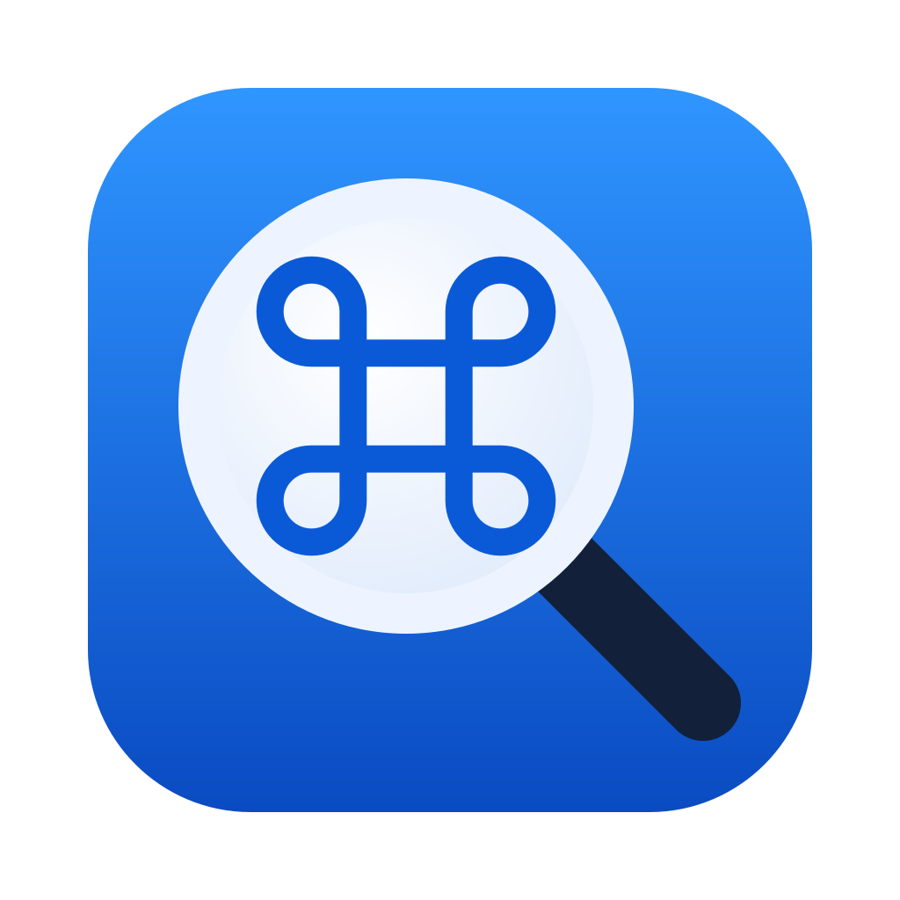
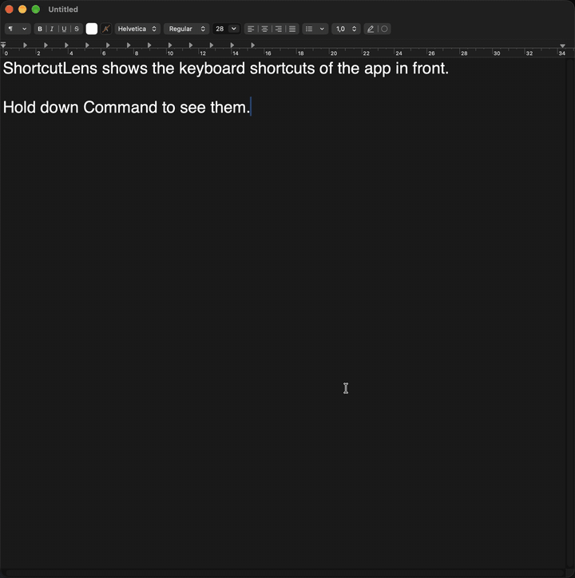

<p align="center">
  
</p>

<h1 align="center">ShortcutLens</h1>

<p align="center">Hold Command to see every keyboard shortcut of the app you are using.</p>

<p align="center">
  <a href="https://github.com/MHusted01/shortcutlens/releases/latest"></a>
  <a href="https://github.com/MHusted01/shortcutlens/actions/workflows/ci.yml"></a>
  <a href="LICENSE"></a>
  
</p>

<p align="center">
  <a href="#install"><b>Install</b></a> ·
  <a href="docs/faq.md">FAQ</a> ·
  <a href="CHANGELOG.md">Changelog</a>
</p>

<p align="center">No telemetry, no network access, no third-party code. See <a href="PRIVACY.md">PRIVACY.md</a>.</p>

<p align="center">
  
</p>

ShortcutLens is a small, native macOS menu bar app. While you hold the
Command key, it shows an overlay with the frontmost app's menu shortcuts,
grouped by menu. Click an entry to run that command.

## Install

Requirements: macOS 14 Sonoma or later, and the Accessibility permission
([why](docs/faq.md#why-does-shortcutlens-need-the-accessibility-permission)).

With [Homebrew](https://brew.sh), from the
[MHusted01/tap](https://github.com/MHusted01/homebrew-tap) tap:

```sh
brew install --cask mhusted01/tap/shortcutlens
xattr -dr com.apple.quarantine /Applications/ShortcutLens.app
```

Run the `xattr` line again after each `brew upgrade --cask shortcutlens`.

Or download the latest `ShortcutLens-x.y.z.zip` from
[Releases](https://github.com/MHusted01/shortcutlens/releases/latest) and
verify it:

```sh
shasum -a 256 -c ShortcutLens-x.y.z.zip.sha256
```

The app is a universal binary (Apple silicon and Intel), ad-hoc signed and
not notarized. Unzip it, move it to `/Applications` and remove the
quarantine flag:

```sh
ditto -x -k ShortcutLens-x.y.z.zip .
mv ShortcutLens.app /Applications/
xattr -dr com.apple.quarantine /Applications/ShortcutLens.app
```

Without that, macOS 15 and later refuse to open the app; right-click > Open
no longer bypasses Gatekeeper there. On macOS 14 right-click > Open also works.

On first launch, a short onboarding in three steps shows what the app does
and how to use it, then walks you through granting the Accessibility
permission in System Settings > Privacy & Security > Accessibility. Reopen it
any time with "Welcome to ShortcutLens…" in the menu bar menu.

Because the signature changes with every release, macOS asks for the
Accessibility permission again after each update. Remove the old entry in
System Settings and add the new app. More in the [FAQ](docs/faq.md).

## Features

- **[Overlay](docs/overlay.md):** hold Command to see the app's menu
  shortcuts, plus the macOS system shortcuts you have turned on. Click an
  entry to run it.
- **[Command palette](docs/palette.md):** double-tap Command to search all
  shortcuts and run one with the keyboard. Works with VoiceOver.
- **Conflicts and App Shortcuts:** entries that share keys are marked, and so
  are shortcuts you defined yourself in System Settings.
- **[Edit shortcuts](docs/editing.md):** right-click an entry to give it new
  keys, or add it to your [favourites](docs/overlay.md#favourites).
- **[Export](docs/export.md):** save the shortcuts as Markdown, or print them
  and save as PDF.
- **[Practice](docs/practice.md):** a quiz that helps you learn an app's
  shortcuts.
- **[Shortcut packs](docs/packs.md):** add shortcuts an app does not show in
  its menus, from local JSON files.
- **[Settings](docs/settings.md):** trigger delay, menu depth, disabled
  items, launch at login. English and Danish, following your system language.

## Development

Requirements: Xcode 26 or later, plus `brew install xcodegen swiftlint swiftformat`.

```sh
make generate   # create ShortcutLens.xcodeproj from project.yml
make test       # Core unit tests with an 80% line coverage gate
make lint       # SwiftLint and SwiftFormat
make check      # no-telemetry check
make build      # Debug build of the app
make integration  # local only: reads Fixtures/MenuFixture through the AX API
```

`make integration` runs inside ShortcutLens.app and needs its Accessibility
permission, so set up local signing (below) first. CI does not run it.

### Local signing (one-time setup)

Ad-hoc signatures change on every build, so macOS forgets the Accessibility
permission after each rebuild. Create a stable self-signed identity once:

```sh
scripts/create-dev-cert.sh   # "ShortcutLens Development" in the login keychain
make build
```

The script also writes the gitignored `Config/Local.xcconfig`, which makes
Debug builds use that identity. Then grant the Accessibility permission once;
later rebuilds keep it:

```sh
open "x-apple.systempreferences:com.apple.preference.security?Privacy_Accessibility"
```

Click **+**, press Cmd+Shift+G, choose
`build/Build/Products/Debug/ShortcutLens.app` and switch it on. The pane is
called Accessibility on older macOS versions; newer ones name it after
device control and data access (Danish: "Styring af enhed og adgang til
data"). The command above opens it either way.
On the first build macOS may ask whether `codesign` may use the key: choose
Always Allow. CI and Release builds stay ad-hoc signed. To undo it, run
`security delete-identity -c "ShortcutLens Development"` and
`rm Config/Local.xcconfig`.

Project layout:

- `ShortcutLensCore/` - Swift package with all testable logic
- `App/` - AppKit/SwiftUI app layer
- `Fixtures/MenuFixture/` - app with known menus, read by `IntegrationTests/`
- `project.yml` - XcodeGen spec (the Xcode project is generated, not committed)

See [CONTRIBUTING.md](CONTRIBUTING.md) for the pull request workflow.

## License

[MIT](LICENSE)
