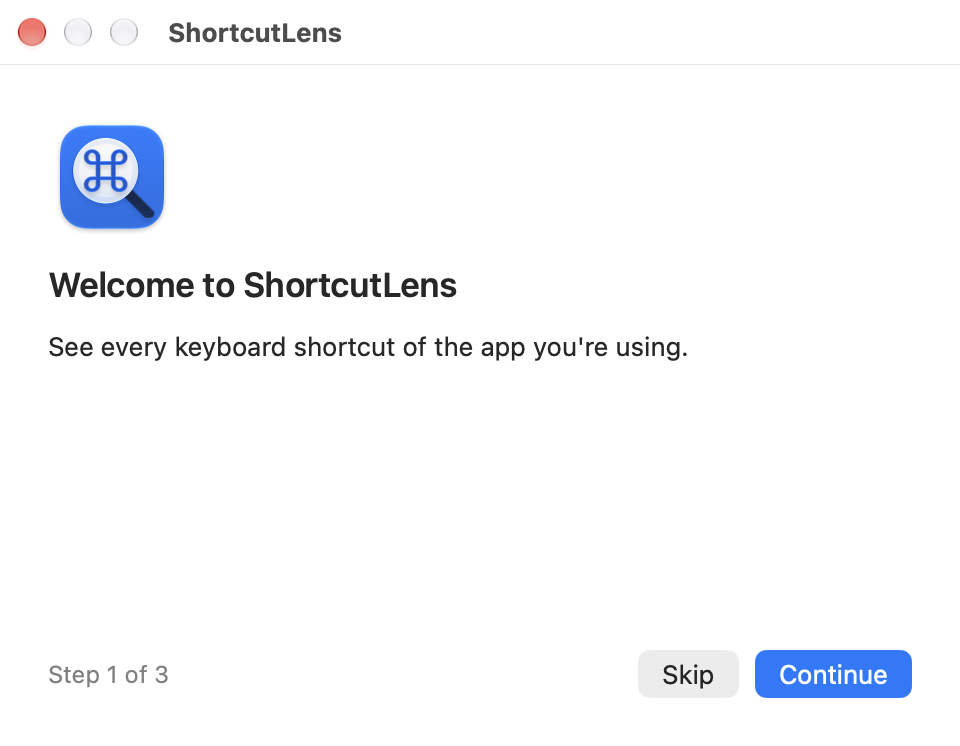
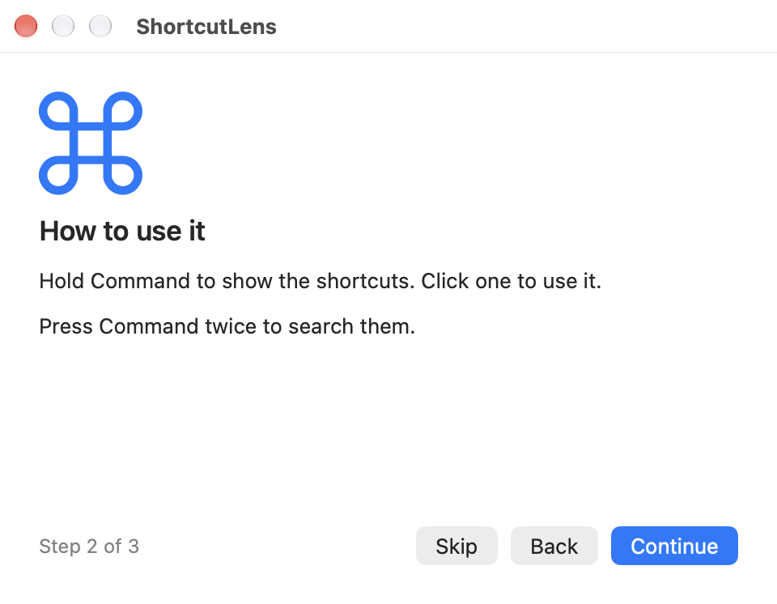
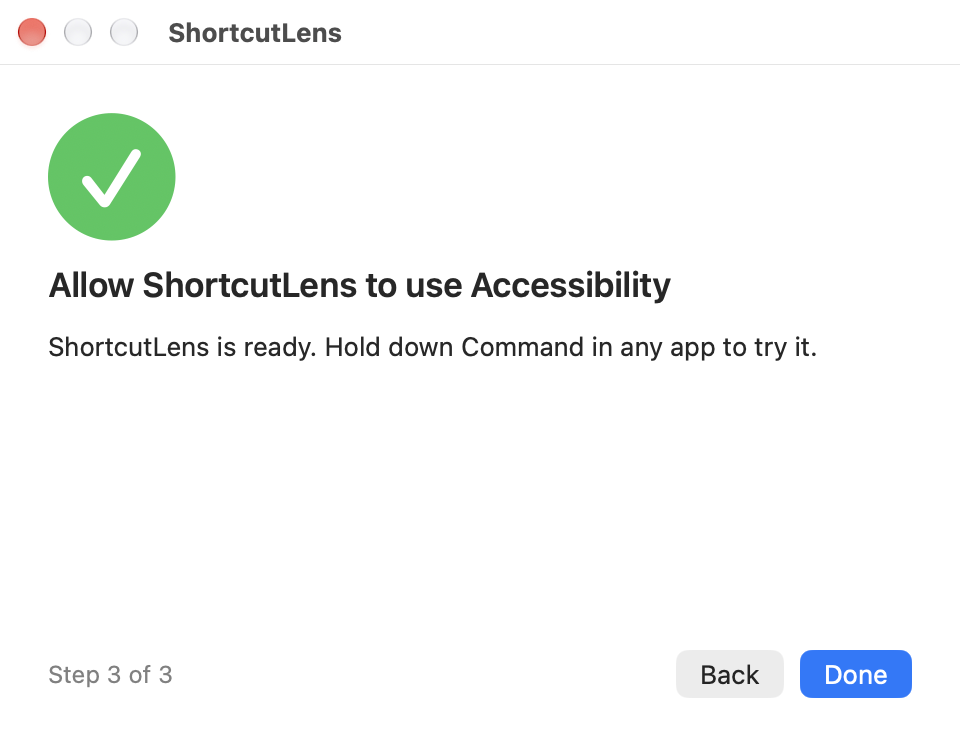

# FAQ and troubleshooting

## Why does ShortcutLens need the Accessibility permission?

Accessibility is the only permission ShortcutLens needs. It is used to read
the frontmost app's menus and to notice key presses while you hold Command
(so Cmd+C does not open the overlay). Input Monitoring is not needed: the app
uses `NSEvent` monitors, not an event tap. It only notes that a key was
pressed, never which one, and checks the time since the last key press
(`CGEventSource`) to notice system shortcuts.

The setting is in System Settings > Privacy & Security > Accessibility. Newer
macOS versions name the pane after device control and data access (Danish:
"Styring af enhed og adgang til data").

The last onboarding step explains the permission and opens that pane. Reopen
it with "Welcome to ShortcutLens…" in the menu bar menu, or with
"Accessibility Permission Required…" while the permission is missing.

<table>
  <tr>
    <td>
      <picture>
        <source media="(prefers-color-scheme: dark)" srcset="images/onboarding-1-dark.png">
        
      </picture>
    </td>
    <td>
      <picture>
        <source media="(prefers-color-scheme: dark)" srcset="images/onboarding-2-dark.png">
        
      </picture>
    </td>
    <td>
      <picture>
        <source media="(prefers-color-scheme: dark)" srcset="images/onboarding-3-dark.png">
        
      </picture>
    </td>
  </tr>
</table>

## The permission is gone after an update

The app is ad-hoc signed, so its signature changes with every release and
macOS asks for the Accessibility permission again after each update. Remove
the old ShortcutLens entry in System Settings > Privacy & Security >
Accessibility, then add the new app from `/Applications` and switch it on.
If the switch is on but nothing happens, remove the entry and add it again.

## macOS says the app cannot be opened

The app is not notarized. Remove the quarantine flag after moving it to
`/Applications`:

```sh
xattr -dr com.apple.quarantine /Applications/ShortcutLens.app
```

macOS 15 and later refuse to open the app without that; right-click > Open
no longer bypasses Gatekeeper there. On macOS 14 right-click > Open also works.

## The overlay does not appear

- Check that ShortcutLens is running: its icon is in the menu bar.
- Check the Accessibility permission (see above). After an update it has to be
  granted again.
- Hold Command alone, without pressing another key, for as long as
  **Hold Command for** in [Settings](settings.md) (default 1.0 s). Pressing
  another key, clicking or a system shortcut cancels the overlay.
- If an app with very deep menus is slow to show, lower **Menu depth** in
  [Settings](settings.md).

## The overlay opens together with another app

Other apps that react to holding Command, such as CheatSheet, open at the
same time as ShortcutLens. Quit the other app or change its trigger while you
use ShortcutLens.

## Double-tapping Command also starts Dictation

If macOS Dictation is set to "Press Command Key Twice" (System Settings >
Keyboard > Dictation > Shortcut), both react to the double tap. In ShortcutLens
Settings > General, set **Open palette** to Double-tap Option or Double-tap
Control, or pick another Dictation shortcut.

## Chrome or another Chromium app shows the wrong enabled state

Chromium-based apps (Chrome, Edge, Brave, Electron apps) may report whether a
menu item is enabled from an earlier state, so **Show disabled items** can
dim the wrong entries there. This is tracked in
[#98](https://github.com/MHusted01/shortcutlens/issues/98).

## A shortcut I know about is missing

ShortcutLens shows what the app puts in its menu bar. Shortcuts that an app
has but does not show in its menus can be added with a
[shortcut pack](packs.md).

## Something else

Search the [existing issues](https://github.com/MHusted01/shortcutlens/issues?q=is%3Aissue)
or [open a bug report](https://github.com/MHusted01/shortcutlens/issues/new/choose).
