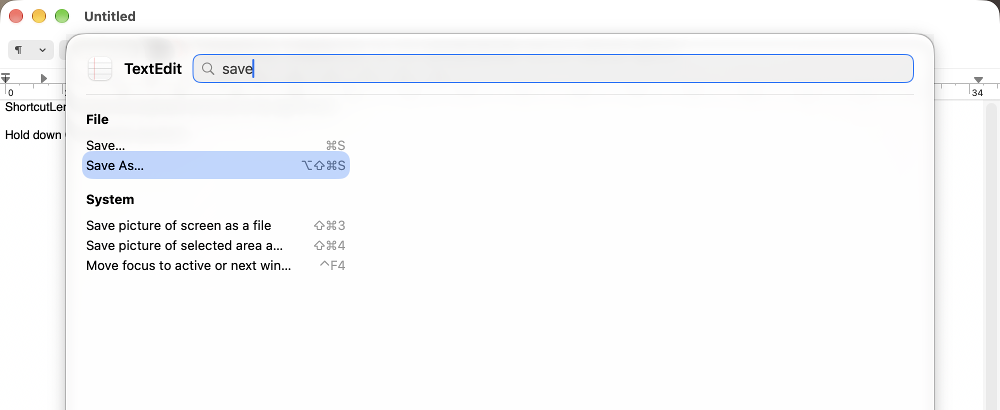

# Command palette

Double-tap Command (press and release it twice quickly) to open the
[overlay](overlay.md) as a command palette. It stays open without holding
Command:

<picture>
  <source media="(prefers-color-scheme: dark)" srcset="images/palette-dark.png">
  
</picture>

- Type to filter the shortcuts by name; case and accents are ignored.
- Up and Down select an entry, Left and Right jump between columns, Return
  runs the selected entry.
- Escape clears the search; a second Escape closes the palette. Clicking
  outside it or switching apps closes it too.

When nothing matches the search, the palette says "No matching shortcuts".

With VoiceOver, the palette announces the app, the number of matches and the
selected entry, reads keys as words ("Command Shift S") and lists section
headings in the rotor.

If macOS Dictation is set to "Press Command Key Twice" (System Settings >
Keyboard > Dictation > Shortcut), both react to the double tap. Pick another
Dictation shortcut; a setting for the palette trigger is planned.
