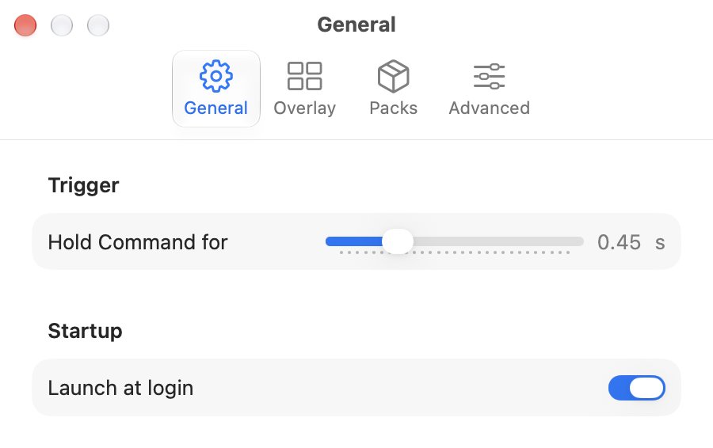
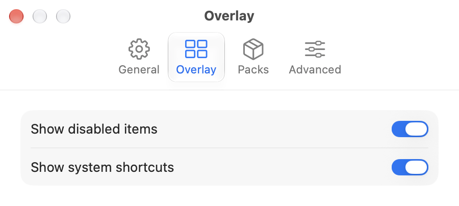
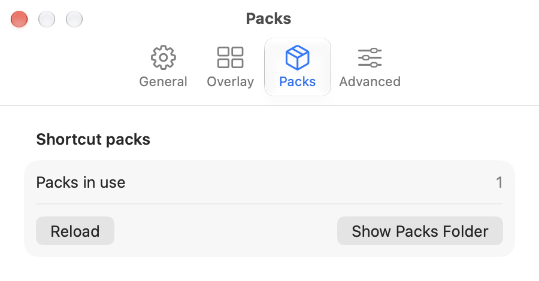
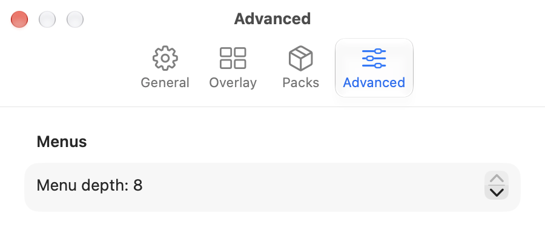

# Settings

Open them from the ShortcutLens menu bar icon > Settings… (Cmd+,). Changes
apply at once and are stored locally in the app's preferences.

The window has four tabs and opens on the one you used last.

## General

<picture>
  <source media="(prefers-color-scheme: dark)" srcset="images/settings-general-dark.png">
  
</picture>

- **Hold Command for:** how long Command must be held before the overlay
  shows, 0.1 to 1.5 s (default 1.0 s).
- **Launch at login:** start ShortcutLens when you log in. If macOS asks for
  approval, allow it in System Settings > General > Login Items.

## Overlay

<picture>
  <source media="(prefers-color-scheme: dark)" srcset="images/settings-overlay-dark.png">
  
</picture>

- **Show disabled items:** also list commands that are greyed out in the
  app's menu right now. They are dimmed and cannot be run.
- **Show system shortcuts:** end the overlay with the System section (on by
  default). System rows are display-only.

## Packs

<picture>
  <source media="(prefers-color-scheme: dark)" srcset="images/settings-packs-dark.png">
  
</picture>

- **Shortcut packs:** how many packs are in use, and any pack file that could
  not be loaded, with the reason. Show Packs Folder opens the folder for your
  own packs. See [packs.md](packs.md) for the format.

## Advanced

<picture>
  <source media="(prefers-color-scheme: dark)" srcset="images/settings-advanced-dark.png">
  
</picture>

- **Menu depth:** how many submenu levels are read, 1 to 8 (default 8).
  Lower it if an app with very deep menus is slow to show.
